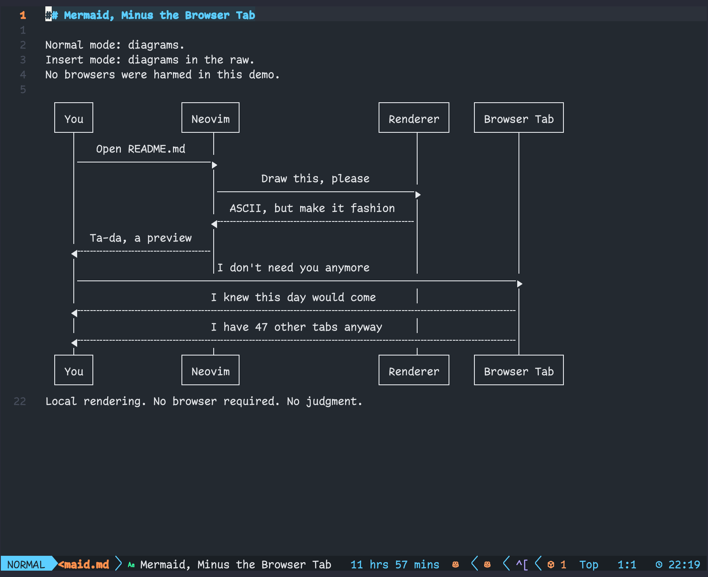
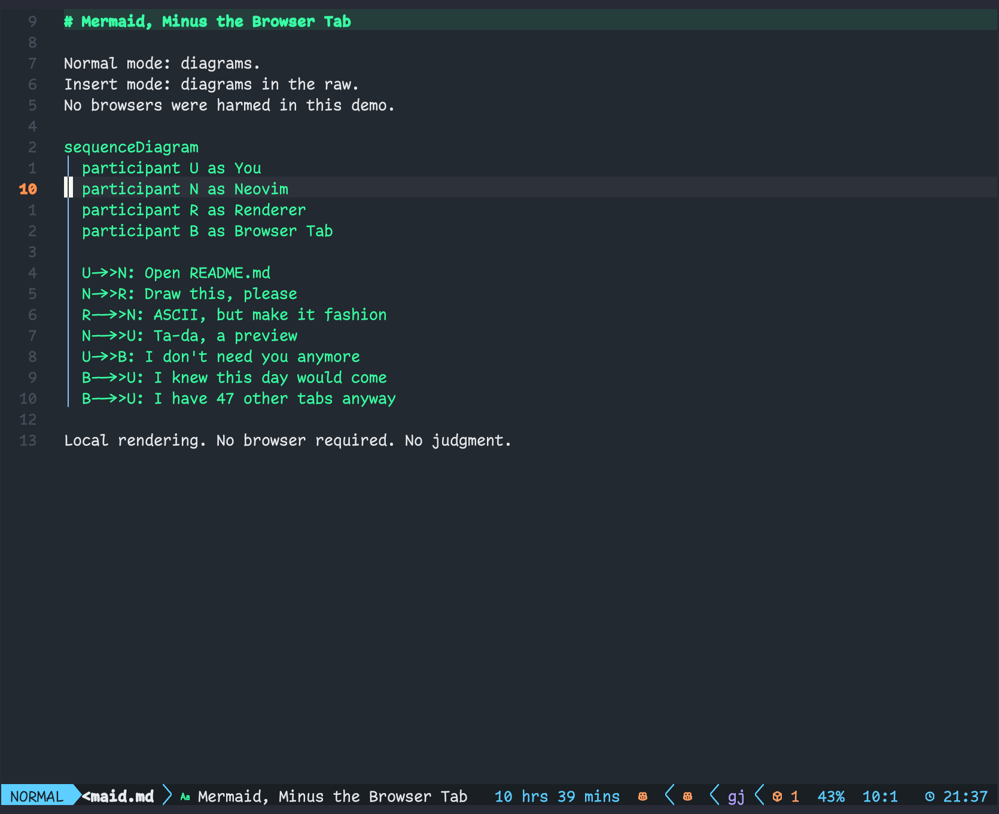
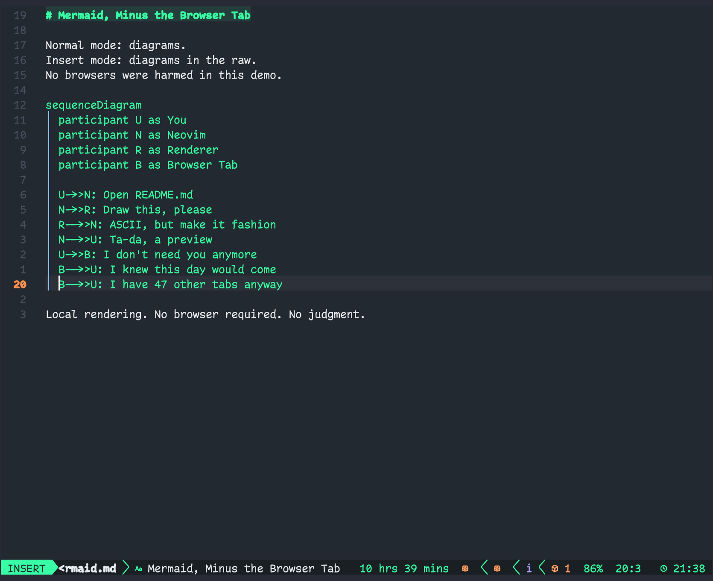
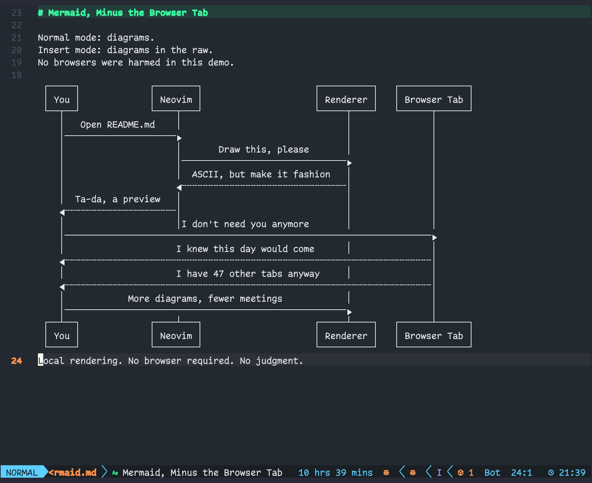

# beautiful-mermaid.nvim

A Neovim plugin for rendering Mermaid diagrams as ASCII art in Markdown buffers.



## Features

- **ASCII mode** renders diagrams locally, with no browser or image backend.
- Moving into a Mermaid block reveals its source.
- Insert mode shows the source while you edit.
- CJK-aware layout for mixed Chinese and English diagrams.

Move into a Mermaid block to reveal its source. Insert mode keeps the source visible while you edit.

| Normal inside block | Insert source |
| --- | --- |
|  |  |

Leave Insert mode or move outside the block to render the updated diagram.



## Requirements

- Neovim 0.12 or later
- the `markdown` Tree-sitter parser
- Node.js 22 or later and npm

## Installation

With lazy.nvim:

```lua
{ "neo-f/beautiful-mermaid.nvim" }
```

Install the Markdown parser if it is not already available. For example, with nvim-treesitter:

```vim
:TSInstall markdown
```

lazy.nvim runs `build.lua` automatically after installing or updating the plugin. `node_modules` is not committed.

## Commands

| Command | Action |
| --- | --- |
| `:MermaidPreview` | Toggle preview in the current Markdown buffer. |
| `:MermaidRefresh` | Clear cached output and render again. |

## Editing behavior

- **Normal mode:** the diagram stays rendered while the cursor is outside its Mermaid block.
- **Normal mode inside a block:** the source replaces the preview so it can be read.
- **Insert mode:** the source is shown for editing.
- **Leaving Insert mode or moving outside the block:** the rendered preview returns.
- **Render failure:** the source remains visible and an error is reported.

## Markdown renderers

Only one plugin should decorate Mermaid blocks. If you use `render-markdown.nvim`, disable its handling for Mermaid while retaining its other Markdown features:

```lua
{
  "MeanderingProgrammer/render-markdown.nvim",
  opts = {
    code = {
      disable = { "mermaid" },
    },
  },
}
```

If you use `snacks.image`, disable its document image integration for this workflow to avoid duplicate rendering. This plugin does not require Snacks.

## How it works

Rendering uses [`beautiful-mermaid`](https://github.com/lukilabs/beautiful-mermaid). Previews are drawn with extmarks.

## Limitations

- `beautiful-mermaid` supports a subset of Mermaid syntax, not the full Mermaid.js language. See its supported diagram types and syntax.
- CJK width handling covers common full-width scripts. Complex emoji sequences may still be misaligned in ASCII mode.

## Development

Clone the repository and install the locked renderer dependencies:

```sh
npm ci --prefix tools/mermaid --ignore-scripts --no-audit --no-fund
```

For a local lazy.nvim checkout:

```lua
{ dir = "/path/to/beautiful-mermaid.nvim" }
```

## License

MIT. See [LICENSE](LICENSE).
